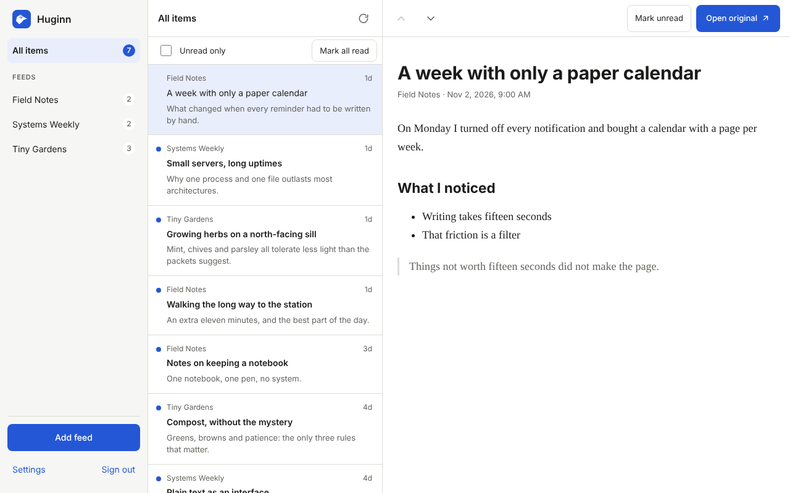
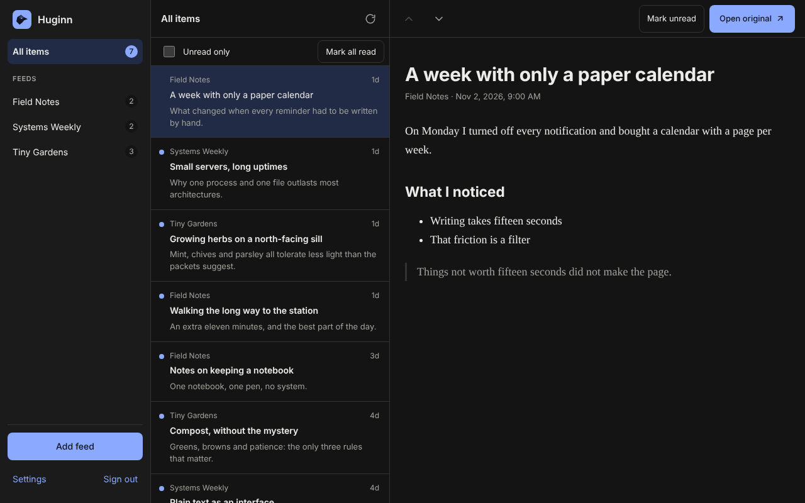
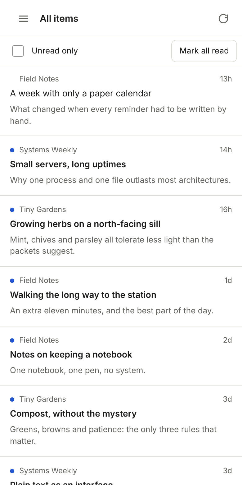
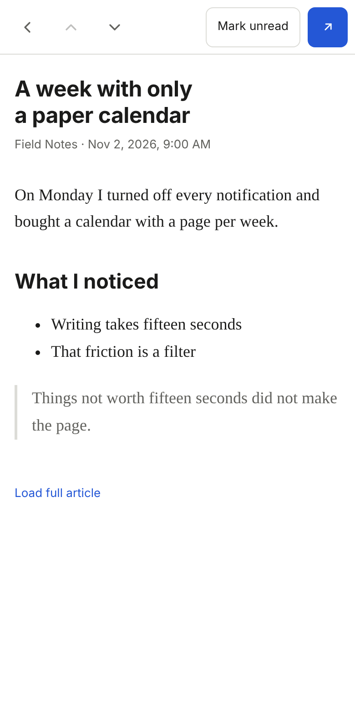

<p align="center">
  
</p>

<h1 align="center">Huginn</h1>

<p align="center">
  A small, fast, self-hosted RSS reader.<br>
  One Go binary and one SQLite file.
</p>

<p align="center">
  
  
</p>

## Features

- **Reads RSS, Atom and JSON Feed.** Paste a feed's address, or just a site's address and Huginn finds its feed.
- **Three panes on a desktop, one at a time on a phone.** Feeds, articles and the reader.
- **Unread counts, read and unread, "unread only" and "mark all read".**
- **Import and export OPML**, the format every feed reader understands.
- **Several users.** Each has their own feeds and read state. The first account is the administrator and adds the others.
- **Safe to read.** Article HTML is cleaned with an allow-list before it is shown: no scripts, frames, forms or styles, and links open in a new tab without handing over the page.
- **Polite to the sites it follows.** Conditional requests so unchanged feeds cost almost nothing, one request at a time per site, a size limit, and a longer wait after repeated failures.
- **Light and dark**, following the device or set by you.
- **Accessible.** Every screen passes an automated axe check in both themes, on a phone and a desktop.
- **Tiny.** The whole interface is about 30 KB compressed. There are no other services to run.

<p align="center">
  
  
</p>

## Run it

You need [Docker](https://docs.docker.com/get-docker/). The image runs on PCs, servers and Raspberry Pi (amd64 and arm64).

```sh
docker run -d --name huginn --restart unless-stopped \
  -p 8080:8080 -v huginn-data:/data \
  dbohry/huginn:latest
```

Or with Docker Compose, using the [`docker-compose.yml`](docker-compose.yml) in this repository:

```sh
docker compose up -d
```

Then open <http://localhost:8080>. The first visit asks you to create the administrator account. **Whoever opens the page first creates it**, so do this before you share the address.

Everything Huginn stores lives in the `/data` volume. To back it up, copy that volume.

> To build the image yourself, run `docker build -t huginn .` and use `huginn` instead of `dbohry/huginn:latest` above.

### Settings

All are optional.

| Variable | Default | Meaning |
|---|---|---|
| `HUGINN_ADDR` | `:8080` | Address the server listens on |
| `HUGINN_DATA_DIR` | `/data` | Directory that holds the database |
| `HUGINN_BLOCK_PRIVATE_NETWORKS` | `false` | Set to `true` to refuse feeds on private networks (this machine, your home or office network, link-local and similar) |

### Locked out?

There is no password-reset email. From the machine that runs Huginn:

```sh
docker exec huginn /huginn reset-password <username>
```

It prints a temporary password and signs that user out everywhere. They choose a new one when they sign in.

### Good to know

- By default Huginn fetches the addresses you give it, including addresses on your own network, so that feeds from your other services work. If other people have accounts, set `HUGINN_BLOCK_PRIVATE_NETWORKS=true` so nobody can use Huginn to probe your network. It checks the address actually connected to, so redirects and names that resolve to private addresses are refused too.
- Put Huginn behind a reverse proxy with HTTPS if you reach it from outside your home network. It marks its cookie `Secure` when the proxy sends `X-Forwarded-Proto: https`.
- Pictures inside articles are loaded by your browser straight from the feed's site, over HTTPS only.
- Each feed keeps its newest 1000 articles.

## Develop

See [docs/DEVELOPMENT.md](docs/DEVELOPMENT.md) for the commands and the layout, and [docs/DESIGN.md](docs/DESIGN.md) for why it is built this way.

## Name

Huginn ("thought") is one of Odin's two ravens. Every day it flies out over the world and returns with the news.

## License

[MIT](LICENSE)
